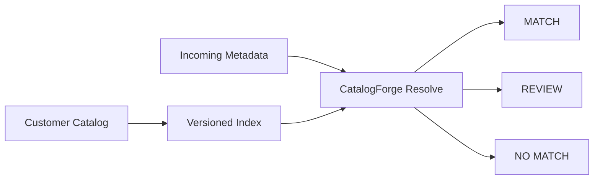

# CatalogForge

CatalogForge is a B2B music catalog reconciliation project.

It helps music companies match messy incoming metadata against their own reference catalogs, especially when spelling, language, and metadata fields do not line up perfectly.

This is a small public showcase. All example records are synthetic.

## What it does

- Bring-your-own-catalog reconciliation
- Versioned catalog snapshots
- Batch resolution jobs
- Arabic / Latin identity matching
- Ranked candidate matching
- MATCH / REVIEW / NO_MATCH decisions
- Reason codes for operators

## Workflow



## Example

```json
{
  "customer_record_id": "incoming-001",
  "track_title": "Laylet Saif",
  "primary_artist": "Lina Kareem"
}
```

Possible result:

```json
{
  "source_customer_id": "incoming-001",
  "selected_target_id": "target-001",
  "decision": "MATCH",
  "reason_codes": ["HIGH_SCORE", "CLEAR_MARGIN"]
}
```

## Technical notes

The private implementation uses Node.js, Python, SQLite, REST APIs, OpenAPI, graph-based ranking, automated tests, and container-oriented deployment.

Selected internal engineering benchmarks:

| Component | Metric | Result |
|---|---|---:|
| Arabic / Latin identity | MRR | ~0.790 |
| Arabic / Latin identity | Recall@1 | ~0.706 |
| Arabic / Latin identity | Recall@5 | ~0.898 |
| ComplEx graph model | MRR | ~0.647 |
| ComplEx graph model | Hits@10 | ~0.812 |

These are engineering benchmarks, not customer-specific performance guarantees.

## More

- [Architecture](docs/architecture.md)
- [API example](docs/api-examples.md)
- [Synthetic examples](examples/)

## Public showcase scope

This repository contains only sanitized documentation and synthetic examples. Production data, customer records, credentials, private datasets, internal paths, and private implementation details are not included.


## Full System Overview

CatalogForge is built as a multi-layer AI platform rather than a single matching model.

The private system includes catalog normalization, a music knowledge graph, multiple machine-learning model families, multilingual identity resolution, catalog intelligence, commercial API infrastructure, and customer-owned catalog reconciliation.

See [System Overview](docs/system-overview.md).
