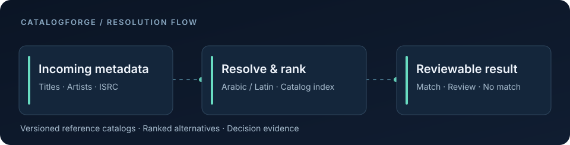

# CatalogForge

**Music catalog matching, built for messy metadata.**

The same recording can appear under different spellings, scripts, or incomplete credits. CatalogForge compares incoming music metadata with a versioned reference catalog, ranks likely matches, and keeps uncertain cases visible for review.

### What it handles

- **Cross-script names** — Arabic and Latin spellings, transliteration, and title variations.
- **Catalog reconciliation** — customer-owned reference catalogs, versioned snapshots, and batch resolution.
- **Reviewable outcomes** — `MATCH`, `REVIEW`, or `NO_MATCH`, with ranked alternatives and reason codes.

### A record, two representations

| Incoming metadata | Reference catalog |
| --- | --- |
| **Laylet Saif** · Lina Kareem | **ليلة صيف** · لينا كريم |

The resolver compares the available evidence and proposes candidates. The decision layer can accept a strong match, request review, or leave the record unmatched. This pair is illustrative, not a measured accuracy result.

### How it fits together

Python handles acquisition and catalog preparation. The Node.js layer serves identity resolution, catalog matching, and APIs. Graph and ML research support separate intelligence workflows; not every model runs for a catalog-match request.

[Architecture](docs/architecture.md) · [API shape](docs/api-examples.md) · [Synthetic input](examples/sample-input.json) · [Synthetic output](examples/sample-output.json)

---

This is a public view of an actively developed private system. Examples are synthetic. Independent accuracy validation and commercial deployment readiness are ongoing work.
