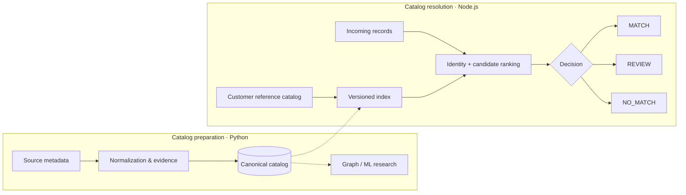

# Architecture

CatalogForge separates data preparation from serving, so catalog matching does not require loading every research model.

The main flow is reference-catalog matching: resolve Arabic/Latin variants, rank candidates, and return a traceable decision. Research models are separate from the lightweight matching runtime.

[Back to overview](../README.md)
