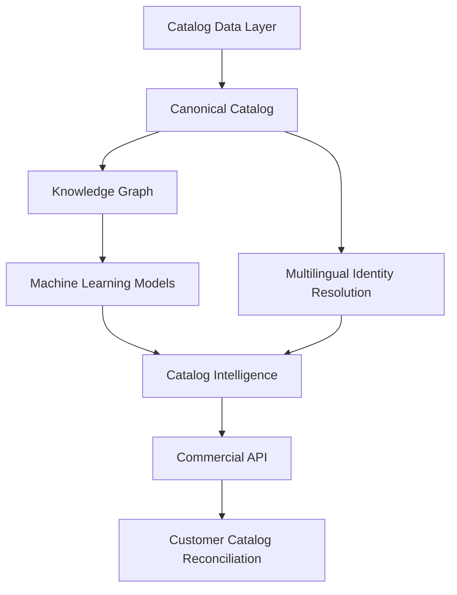

# System Overview

CatalogForge is more than a single metadata matcher. The private project is organized as a multi-layer AI system for music catalog intelligence.

## 1. Catalog Layer

The system maintains a structured canonical representation of music entities and relationships.

It supports normalization, deduplication, validation, and reproducible catalog snapshots.

## 2. Knowledge Graph

Catalog entities are transformed into a graph representation connecting tracks, artists, albums, releases, and other catalog relationships.

The graph provides additional evidence for machine-learning and ranking tasks.

## 3. Machine Learning

Several model families have been developed and evaluated, including:

- graph representation models
- link prediction models
- metadata encoders
- cold-start models
- catalog integrity models
- multilingual identity models

Model promotion is benchmark-driven rather than based only on architecture choice.

## 4. Arabic / Latin Identity

A dedicated identity layer handles cross-script metadata such as Arabic and Latin artist-name variants.

This is useful when catalogs contain transliteration, alternate spelling, or mixed-language metadata.

## 5. Catalog Intelligence

The intelligence layer supports tasks such as:

- entity resolution
- catalog reconciliation
- anomaly detection
- relationship validation
- candidate ranking
- metadata quality analysis
- cold-start inference
- recommendation signals

## 6. Commercial API Layer

The private system also includes API infrastructure for B2B use:

- authenticated API access
- product entitlements
- usage metering
- quotas
- OpenAPI documentation
- readiness checks
- automated HTTP regression tests

## 7. Customer-Owned Catalog Resolution

The current commercial direction is based on customer-owned catalogs.

A customer can create a versioned reference catalog, submit incoming metadata in batches, and receive:

- MATCH
- REVIEW
- NO MATCH
- ranked alternatives
- structured reason codes

This public repository intentionally shows the architecture and product concepts without exposing private data, internal implementation details, or production assets.
